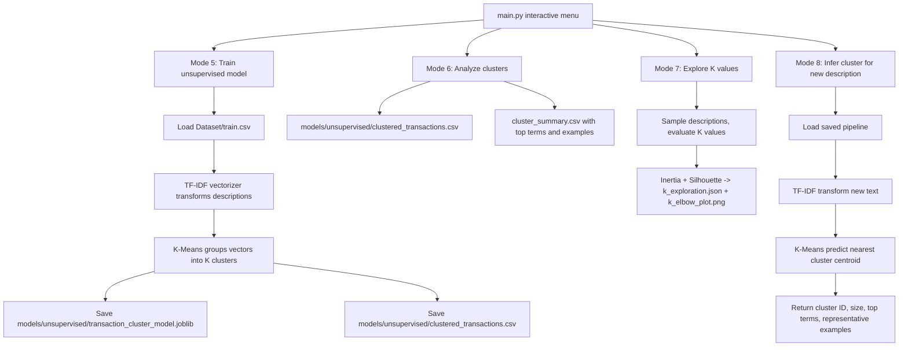

# SpendSense

**SpendSense** is an educational machine-learning project for transaction categorization and spending analysis.

It currently provides two pipelines:

1. **Supervised classification** — predict an expense category from a transaction description.
2. **Unsupervised clustering** — discover groups in transaction descriptions without using category labels.

**What it does today (supervised):** you give it a transaction description like *"Uber ride to office"* and it predicts the expense category — for example `Transfer` — with a confidence score.

**What it does today (unsupervised):** it groups similar transaction descriptions into clusters based on TF-IDF features, without referencing the known categories.

---

## How It Works — Supervised (big picture)

```
Dataset/transactions-synthetic.csv          (68,000 labeled transactions - original, never modified)
        │
        ▼  prepare_dataset.py
┌─────────────────────┬──────────────────────┐
│ Dataset/train.csv   │ Dataset/test.csv     │   80% / 20% split
│ 36,554 descriptions │ 9,138 descriptions   │   (split by DESCRIPTION, so the
└─────────────────────┴──────────────────────┘    model can never "peek" at test data)
        │                            │
        ▼  train_model.py            ▼
   ┌─────────┐   TF-IDF turns text into numbers  ┌───────────────────────┐
   │ TRAIN   │ ─────────────────────────────────▶ │ Logistic Regression   │
   └─────────┘                                    └───────────────────────┘
        │                            ▲
        ▼                            │ loads
   models/expense_category_model.joblib  ← the saved, trained model
        │
        ▼  predict.py
   "Netflix monthly subscription" → Subscription (93.7% confidence)
```

In short:

1. **Prepare** — clean split of the data into train/test, with no overlap.
2. **Train** — TF-IDF converts text into numbers, Logistic Regression learns which words mean which category.
3. **Save** — the trained model is frozen into one file (`models/expense_category_model.joblib`).
4. **Predict** — any program loads that file and categorizes new text in under a second.

---

## How It Works — Unsupervised (big picture)

```
Dataset/train.csv   (36,554 descriptions)
        │
        ▼  clustering.py
┌────────────────────────────────────────────┐
│ 1. Drop missing/empty descriptions         │
│ 2. Deduplicate by description             │
│ 3. TF-IDF vectorize descriptions           │
│ 4. K-Means fit and predict cluster IDs     │
│ 5. Save pipeline + clustered output        │
└────────────────────────────────────────────┘
        │
        ▼
models/unsupervised/transaction_cluster_model.joblib
models/unsupervised/clustered_transactions.csv
        │
        ▼  analyze_clusters.py / explore_k.py / inference.py
Cluster summaries, K evaluation, and new-description cluster assignment
```

In short:

1. **Load** — dataset is loaded and validated.
2. **Clean** — missing descriptions are dropped and duplicates are removed.
3. **Vectorize** — TF-IDF converts text into a numeric shape.
4. **Cluster** — K-Means assigns each description to one of K clusters.
5. **Save** — the complete TF-IDF + K-Means pipeline is persisted with Joblib.
6. **Analyze** — cluster summaries show counts, top terms, and representative examples.

**Important:** the clustering model does **not** use the `category` column. K-Means discovers text patterns; categories are compared only afterward for interpretation.

---

## How to Run It

Start the interactive menu (PyCharm: just press ▶ Run on `main.py`):

```bash
python main.py
```

```
=======================================================
SpendSense
=======================================================
  1) train + evaluate + save model   (full experiment)
  2) train + save model only         (no evaluation)
  3) test the saved model            (on test.csv)
  4) predict                         (type text or give a CSV)
  5) train unsupervised clustering model
  6) analyze discovered clusters
  7) explore different values of K
  8) predict a cluster for a new description
  q) quit
```

The same thing from the terminal:

```bash
python main.py 1                                  # full supervised experiment (~1 min)
python main.py 2                                  # train + save only
python main.py 3                                  # re-grade the saved supervised model
python main.py 4 "Netflix subscription"           # supervised prediction
python main.py 5                                  # train K-Means clustering model
python main.py 6                                  # analyze discovered clusters
python main.py 7                                  # explore K values
python main.py 8                                  # inference for a new description
python main.py predict --csv Dataset/sample_input.csv   # batch supervised prediction
```

- **Mode 1** = train + test + save. Reports accuracy, F1, confusion matrix, and mistake list.
- **Mode 2** = train + save only. Faster; test.csv is never touched.
- **Mode 3** = grades the *saved* supervised model again, without retraining.
- **Mode 4** = supervised everyday use. Works with single texts, a CSV file, or built-in samples.
- **Mode 5** = trains the unsupervised TF-IDF + K-Means pipeline on descriptions only.
- **Mode 6** = prints/analyzes what each cluster contains (counts, top terms, examples).
- **Mode 7** = evaluates inertia and silhouette for a range of K values.
- **Mode 8** = enter any transaction description and get its cluster ID plus context.

**You only train when the model or data changes. Predicting is instant and can be done as often as you like.**

---

## Current Results

### Supervised baseline

TF-IDF (unigrams + bigrams) + Logistic Regression, evaluated on 9,138 unseen test descriptions:

| Metric | Score |
|---|---|
| Accuracy | **99.28%** |
| Error rate | 0.72% (66 mistakes out of 9,138) |
| Categories | 17, all predicted well |

Most common confusions are between similar categories (e.g. Shopping ↔ Subscription). Full mistake list: `models/misclassified.csv`.

### Unsupervised baseline

TF-IDF (unigrams + bigrams) + K-Means, K=10, trained on 36,554 unique descriptions:

| Metric | Score |
|---|---|
| Vocabulary features | 12,281 |
| K | 10 |
| Inertia | 34,432.9 |
| ARI vs categories | 0.0637 |
| NMI vs categories | 0.2547 |

K exploration used `sample_size=5000`:

| K | Inertia | Silhouette |
|---|---:|---:|
| 2 | 4,869.8 | 0.011 |
| 5 | 4,767.4 | 0.017 |
| 10 | 4,610.7 | 0.030 |
| 15 | 4,533.2 | 0.032 |
| 18 | 4,453.9 | 0.044 |
| 20 | 4,438.4 | 0.040 |

Silhouette values remain low, indicating that text-only TF-IDF clusters are not well separated in high-dimensional space. This is expected because TF-IDF captures lexical similarity, not semantic financial categories.

---

## Project Structure

```
SpendSense/
│
├── main.py                      ← START HERE: menu / command dispatcher
│
├── src/
│   ├── prepare_dataset.py       creates train.csv / test.csv / ambiguous.csv
│   ├── inspect_dataset.py       read-only dataset report
│   ├── train_model.py           trains + evaluates + saves the supervised model
│   ├── predict.py               loads the saved supervised model, predicts new text
│   └── unsupervised/
│       ├── clustering.py        K-Means clustering pipeline
│       ├── analyze_clusters.py  cluster analysis and summary
│       ├── explore_k.py         K-value exploration (Elbow + Silhouette)
│       ├── compare_clusters_to_labels.py  post-hoc cluster vs category comparison
│       └── inference.py         interactive new-description cluster assignment
│
├── Dataset/
│   ├── transactions-synthetic.csv   original data (never modified)
│   ├── train.csv / test.csv         modeling split (80/20, no leakage)
│   ├── ambiguous.csv                descriptions with conflicting labels
│   ├── sample_input.csv             example file for batch prediction
│   └── Testsets/                    additional unseen test files
│
├── models/
│   ├── expense_category_model.joblib   THE supervised trained model
│   ├── confusion_matrix.png            supervised confusion matrix heatmap
│   ├── misclassified.csv               supervised error analysis file
│   └── unsupervised/
│       ├── transaction_cluster_model.joblib  unsupervised pipeline
│       ├── clustered_transactions.csv        clustered descriptions
│       ├── cluster_summary.csv               per-cluster summary
│       ├── cluster_category_comparison.csv   cluster vs category metrics
│       ├── clustering_metadata.json          K, counts, inertia, vocabulary size
│       ├── k_exploration.json                K-value metrics
│       └── k_elbow_plot.png                  K-value plot
│
├── notebooks/                   future exploration
├── tests/
│   └── test_unsupervised.py     unittest suite for unsupervised components
├── requirements.txt             pandas, numpy, scikit-learn, joblib, matplotlib
└── README.md
```

Typical flow: `prepare_dataset.py` once → `train_model.py` when needed → `predict.py` any time.

Typical unsupervised flow: `clustering.py` once → `analyze_clusters.py` when needed → `inference.py` any time.

---

## Supervised vs Unsupervised

- **Supervised** (`train_model.py`): learns from labeled data — input text maps to known category labels.
- **Unsupervised** (`src/unsupervised/`): finds structure in the descriptions *without* using the category labels during model fitting.

The unsupervised pipeline uses only the `description` column for clustering. Existing category labels are never used to fit the model, choose K, or tune hyperparameters. They may be compared *after* clustering (see `compare_clusters_to_labels.py`) for interpretation only.

---

## Unsupervised Pipeline Usage

```bash
# 1. Cluster transactions
.venv\Scripts\python src\unsupervised\clustering.py --k 10

# 2. Analyze clusters
.venv\Scripts\python src\unsupervised\analyze_clusters.py

# 3. Explore different K values
.venv\Scripts\python src\unsupervised\explore_k.py --sample-size 5000

# 4. Optional: compare clusters to existing categories (post-hoc only)
.venv\Scripts\python src\unsupervised\compare_clusters_to_labels.py

# 5. Interactive cluster inference for a new description
.venv\Scripts\python src\unsupervised\inference.py

# 6. Run unit tests
.venv\Scripts\python -m unittest tests\test_unsupervised.py -v
```

**Artifacts** are saved under `models/unsupervised/`.

---

## Key Concepts Used

### Supervised vs Unsupervised Learning

- **Supervised learning:** You give the model both the inputs and the correct answers. It learns to predict the answer for new inputs.
- **Unsupervised learning:** You only give the model the inputs. It must discover hidden structure on its own.

### Text Classification vs Clustering

- **Text classification** (supervised): assigns a known label to text.
- **Clustering** (unsupervised): groups similar text together without known labels.

### TF-IDF

TF-IDF turns each transaction description into a list of numbers.

- **TF** = how often a word appears in *this* description.
- **IDF** = how informative that word is across *all* descriptions. Rare words get higher scores.
- A description with unique/rare words gets a distinctive numerical fingerprint.

Example: “WAL-MART” appears in many descriptions, so it has a lower IDF weight than a rare payee name like “SPARKS FLY PIZZA”.

### K-Means

K-Means groups similar description vectors into `K` clusters by:

1. Picking `K` initial center points (centroids).
2. Assigning every description to its closest centroid.
3. Recalculating centroids based on assigned descriptions.
4. Repeating until assignments stabilize.

### K and Centroids

- **K** = the number of groups you want to find.
- **Centroid** = the average position of all descriptions in a cluster. It represents the “center” of that cluster.

K-Means requires you to choose K beforehand. It does **not** discover the optimal K automatically.

### Inertia and the Elbow Method

**Inertia** measures how tightly descriptions are packed around their cluster centers. Lower inertia = tighter clusters.

The **Elbow method** plots Inertia versus K. When Inertia stops dropping sharply, you may be near a useful K. But this is a heuristic, not a guaranteed answer.

### Silhouette Score

Silhouette Score measures how similar a description is to its own cluster compared to other clusters. Ranges from -1 to 1. Higher is generally better.

**Limitation:** In high-dimensional sparse text data, values are often low even for reasonable clusterings.

### `random_state` and `n_init`

- **random_state**: Seeds the random number generator so the same clustering result is produced each run.
- **n_init**: Runs K-Means multiple times with different random starting points and keeps the best result.

### Why Cluster IDs Are Not Expense Categories

K-Means only knows about word similarity. If `“WAL-MART”` and `“TARGET”` both have many shopping-related descriptions, they may end up in the same cluster — but the model never knows that cluster represents "Groceries" or "Shopping". It just learns that these descriptions look alike in TF-IDF space.

- **Logistic Regression** — a fast, interpretable classifier that learns a weight per word for each of the 17 categories.
- **Pipeline** — TF-IDF + classifier saved together as one object, so prediction needs raw text only: no manual preprocessing.
- **Leakage prevention** — the split is done per *description* (not per row), and test.csv is never touched during training. Accuracy is therefore an honest estimate.

The code is written as a learning project: every ML step in `src/` is explained in comments (what it does, why, and how).

---

## Dataset

**Actual dataset used for clustering:** `Dataset/train.csv`

This CSV already contains all unique, non-ambiguous descriptions extracted from the original dataset. We use it for unsupervised exploration because it is already cleaned and deduplicated, and reusing it does not alter the training/evaluation split used for the supervised model.

| Dataset | Rows | Columns | Notes |
|---------|------|---------|-------|
| `Dataset/transactions-synthetic.csv` | 68,000 | `description`, `category` | Original data; never modified |
| `Dataset/train.csv` | 36,554 | `description`, `category` | Used for unsupervised training |
| `Dataset/test.csv` | 9,138 | `description`, `category` | Not used for unsupervised training |
| `Dataset/ambiguous.csv` | 5 | `description`, `categories`, `row_count` | Excluded from training |

Handling rules:

- Missing/empty descriptions are dropped before fitting.
- Duplicate descriptions are removed.
- `category` is **not** used during clustering, K selection, or inference.

A sample of 5,000 rows is used for Silhouette Score evaluation to keep computation reasonable. No rows are discarded from the final clustering output.

---

## Configuration

The following table shows the actual parameters used in `src/unsupervised/clustering.py`:

| Parameter | Value | Purpose |
|-----------|-------|---------|
| `lowercase` | `True` | Normalizes text to lowercase so "WAL-MART" and "wal-mart" are treated the same |
| `ngram_range` | `(1, 2)` | Uses both individual words (unigrams) and adjacent word pairs (bigrams) |
| `min_df` | `2` | Ignores terms that appear in fewer than 2 documents |
| `max_df` | `0.95` | Ignores terms that appear in more than 95% of documents |
| `sublinear_tf` | `True` | Replaces raw term frequency `tf` with `1 + log(tf)` to reduce the impact of very frequent words |
| `n_clusters` | `10` | Starts with 10 clusters (configurable with `--k`) |
| `random_state` | `42` | Makes results reproducible |
| `n_init` | `10` | Runs K-Means 10 times with different starts and keeps the best result |

**Why these values?**

- `ngram_range=(1, 2)` captures important two-word patterns like `"monthly subscription"` and `"web id"` that are meaningful for transaction descriptions.
- `min_df=2` removes accidental typos or IDs that appear only once.
- `max_df=0.95` removes the ubiquitous `[debit]` prefix that appears everywhere and adds no discriminative power.
- `sublinear_tf=True` dampens the effect of repeated word occurrences so one long description does not dominate clustering.

---

## Model Artifacts

| Artifact | Location | Contents |
|----------|----------|----------|
| `transaction_cluster_model.joblib` | `models/unsupervised/` | Complete fitted TF-IDF + K-Means pipeline |
| `clustered_transactions.csv` | `models/unsupervised/` | Every description with its assigned cluster ID |
| `cluster_summary.csv` | `models/unsupervised/` | Per-cluster counts, top terms, and representative examples |
| `clustering_metadata.json` | `models/unsupervised/` | K, random_state, sample count, vocabulary size, inertia |
| `k_exploration.json` | `models/unsupervised/` | Inertia and Silhouette scores for each tested K |
| `k_elbow_plot.png` | `models/unsupervised/` | Visual elbow + silhouette plot |
| `cluster_category_comparison.csv` | `models/unsupervised/` | Optional post-hoc comparison with existing categories; ARI and NMI |

---

## Example Demonstration

> The following example is illustrative. Exact cluster IDs and counts may vary if you retrain.

1. **Start the application:**
   ```powershell
   python main.py
   ```

2. **Train the unsupervised model:**
   ```
   Choose an option: 5
   ```

   Output:
   ```
   Mode 5: TRAIN UNSUPERVISED CLUSTERING MODEL
   INFO: Clustering complete: K=10, 36554 transactions, 12281 vocabulary features
   ```

3. **Inspect a cluster summary:**
   ```
   Choose an option: 6
   ```

   Output saved to `models/unsupervised/cluster_summary.csv`.

4. **Enter a new transaction description:**
   ```
   Choose an option: 8
   ```

   Then type:
   ```
   Enter transaction description: UPI payment to Cafe Aroma for lunch
   ```

   Example output:
   ```
   Predicted cluster: 9
   Cluster size:      18132 transactions
   Top terms:         debit, payment, cashout, payroll, ppd id, id
   Representative descriptions:
     1. [credit] ACME CORP DIR DEP PPD ID: 526062691
     2. [credit] ACME CORP DIR DEP PPD ID: 561452503
   Note: This is NOT a predicted expense category.
   ```

   Notice the warning: None of the words in “UPI payment to Cafe Aroma” were in the training vocabulary, so the assignment may be unreliable.

5. **Explain the result to your audience:**
   - The model mapped the description to a cluster based on TF-IDF similarity.
   - It did **not** predict `Restaurants` or `Transfer` — it only found the closest group of similar descriptions.
   - Cluster IDs are arbitrary groups, not expense categories.

---

## Evaluation and Limitations

### Observed Evaluation Results

From the K exploration run:

- **Inertia:** decreases monotonically as K increases from 2 to 20.
- **Silhouette score:** remains very low (peak around **0.044 at K=18**).
- On the post-training cluster-category comparison:
  - **ARI ≈ 0.064**
  - **NMI ≈ 0.255**

These results tell us that TF-IDF + K-Means finds **text-pattern clusters**, not clean expense-category groups.

### Important Limitations

1. **Text, not finance:** The model discovers patterns in transaction descriptions. It does not know whether a transaction is financially large, frequent, or suspicious.
2. **No amounts or dates:** The dataset contains only `description` and `category`. It lacks transaction amounts, timestamps, account IDs, and merchant details.
3. **Cannot detect fraud from text alone:** A text-only anomaly detector might flag an unusual description, but it cannot tell whether that transaction is financially anomalous.
4. **Synthetic data:** This dataset is synthetic. Patterns found here may not reflect real-world bank descriptions.
5. **Category overlap:** A single cluster can contain multiple true categories, and one category can spread across multiple clusters.

---

## Future Improvements

The following are **possible** next steps but are **not implemented** in this task:

1. **Isolation Forest anomaly detection** on description-derived features. Since there are no amounts or dates, it would only identify unusual descriptions, not unusual spending behavior.
2. **Richer datasets** with timestamps, amounts, and account metadata to enable true spending-pattern analysis.
3. **Alternate embeddings** or sentence transformers to capture semantic similarity instead of pure keyword matching.
4. **Post-hoc cluster labeling** using external knowledge bases or LLM summarization.

---

## Troubleshooting

### Problem: `Model file not found` when using Mode 8

**Solution:** You must train the clustering model first. Use Mode 5 or run:

```powershell
python main.py 5
```

### Problem: Empty or too-short description

**Solution:** Mode 8 expects a valid non-empty string. If you leave it blank, the inference module prints a warning.

### Problem: Warning about unfamiliar words

Example:

```
WARNING: None of the words in this description were seen during training. The cluster assignment may be unreliable.
```

**Solution:** This is expected when the new description uses words outside the TF-IDF vocabulary. The cluster assignment may not be meaningful for such input.

### Problem: Missing Python packages

**Solution:** Make sure you are using the project virtual environment and have installed dependencies:

```powershell
.venv\Scripts\activate
pip install -r requirements.txt
```

### Problem: Want to retrain after changing `Dataset/train.csv`

**Solution:** Just run Mode 5 again or:

```powershell
python src\unsupervised\clustering.py --k 10
```

The old artifacts in `models/unsupervised/` will be overwritten.

### Problem: Tests fail with missing supervised model artifact

**Solution:** The supervised model artifact should exist at `models/expense_category_model.joblib`. If it was deleted, restore it or regenerate it with Mode 1:

```powershell
python main.py 1
```

---

## Architecture and Execution Flow



---

## Current Phase

Phase 1 — Supervised Learning (baseline complete)

Phase 2 — Unsupervised clustering baseline complete

## Future Phases (planned)

- Anomaly detection (Isolation Forest) — text-based detection only; no amounts/timestamps available.
- Spending prediction
- Database integration
- UI/dashboard
- LLM/Misty integration

---

## Summary for Your Presentation

- **Supervised:** Transaction description → known category label.
- **Unsupervised:** Transaction description → TF-IDF vector → K-Means group.
- **K-Means discovers text patterns, not semantic categories.**
- **Cluster IDs are arbitrary.**
- **`category` is used only for post-hoc comparison.**
- **All artifacts live in `models/unsupervised/`.**
